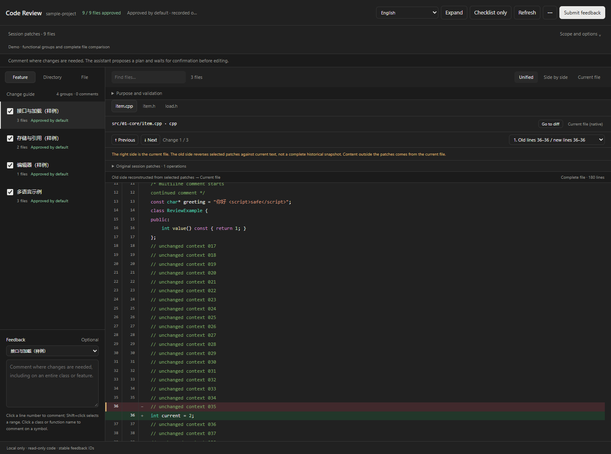
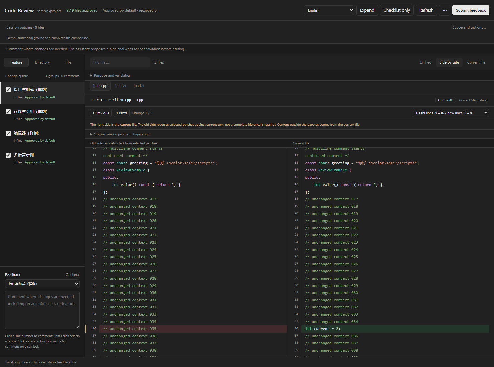
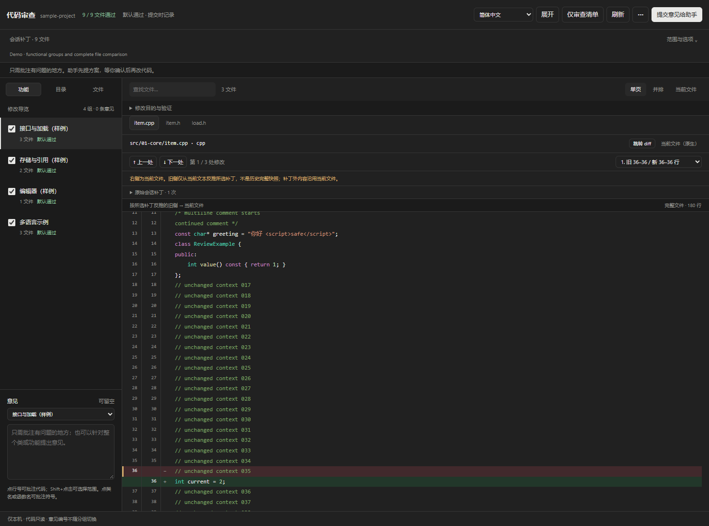
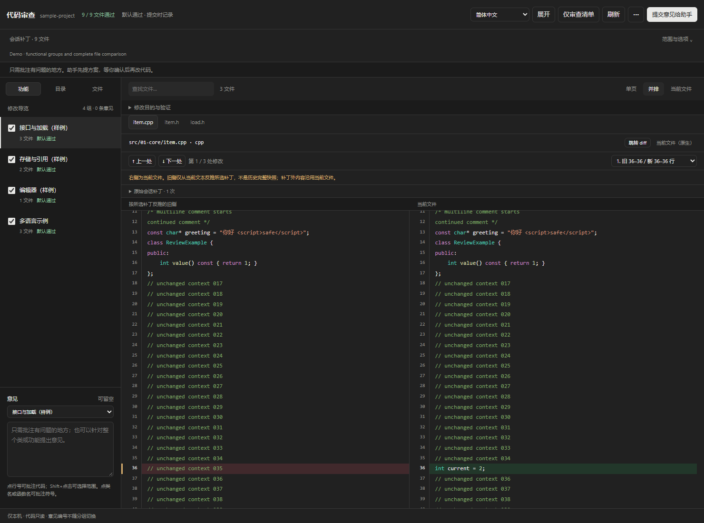

# Local Review · Local Code Review for Codex

[English](#english) | [简体中文](#简体中文)

## English

A standalone Codex Desktop plugin for Windows and Python 3.12+. No additional runtime packages are required; Pygments is bundled under its BSD license. The installation is independent of the project being reviewed: each tool call specifies the current project's root. The plugin has no Git commit, rollback, or patch application endpoints.

### Dark theme preview

The MCP Apps component in dark mode, captured with an isolated sample project in a local protocol test host. Chat-message support is enabled, so **Submit feedback** appears in the top-right corner alongside the native-file action. The images show unified and side-by-side code views; sample code and group names are illustrative.

**Unified view**



**Side-by-side comparison**



### Usage

Clone the source into a directory of your choice. Codex maintains its installed plugin cache separately; review data stays in each project's `.code-review/` directory. `reviews.json` is only a small scope index; each comparison scope's items, annotations, and guide are stored in its own `reviews/<scope-key>.json` shard.

For the standalone page, run `python server.py --root "C:\path\to\project"` or `start.cmd "C:\path\to\project"` from the tool directory. The terminal prints a local URL. Append `?compact=1` for a compact checklist. Press Ctrl+C to stop the server.

After installing the plugin, ask the assistant to call `review_open`. An **MCP Apps** component appears alongside the conversation. By default, it does not open another browser or start an HTTP listener. HTML, CSS, and JavaScript are delivered together as an MCP resource; data reads and writes use local stdio tools. The component's CSP blocks network connections and external resources. It follows host theme and style variables using custom HTML/CSS; it does not bundle the official React UI library.

The Expand button appears only if the host advertises fullscreen support. The native-file action sends a read-only request to the conversation so the assistant can open Codex's native file panel. Submit feedback saves your comments and asks the assistant to propose changes; **it does not confirm a plan**. Message actions are available only when the host advertises messaging support. The custom viewer supports complete session/snapshot comparisons; it does not inject controls into Codex's built-in review editor or assume that every host supports modals.

If the host cannot display MCP Apps, use the standalone page, or explicitly request `browserFallback: true` in `review_open` and open the returned `compactUrl` in a browser panel. Native editors and review panels may show a different range from historical session patches.

The code viewer supports **unified and side-by-side layouts**, retaining all unchanged lines. Added, deleted, and replaced lines are marked with old and new line numbers. Previous/Next change, the location selector, and Alt+↑/↓ navigate changes. You can also view the complete current file; original session patches remain available in a collapsed section. Offline syntax highlighting uses Pygments' complete built-in language registry, including C/C++, C#, Java, Kotlin, Rust, Go, Python, JS/TS, Ruby, PHP, Swift, Dart, SQL, shells, shaders, and common configuration formats. Makefile/Dockerfile names and common shebangs are recognized; unknown formats fall back to plain text. Multiline comments and strings are parsed across the complete file. Light/dark themes retain diff shading.

Snapshots and HEAD comparisons provide complete baselines. When a session log contains only patches, an old side is reconstructed only where context uniquely matches the current file. It is labeled as reconstructed, not a historical snapshot; content outside the patch comes from the current file. If matching fails or a deleted file's original content is missing, the old side is marked unavailable. The current file and uniquely matched historical locations remain visible. No old file content is invented. Assistants should capture snapshots before future edits to enable complete comparisons.

The default navigation uses assistant-prepared functional groups; you can switch to directories or files. These are alternate navigation views and do not rewrite approvals or feedback IDs. The assistant links files across directories using `review_set_guide` and records the purpose and actual validation. Ungrouped files are shown when no guide exists. New review entries are checked by default. Checkbox and comment changes save to the project cache after about 0.7 seconds of inactivity. Opening the page alone does not persist default checkmarks as completed reviews; submitting or exporting saves the current defaults. Unchecking an entry means changes are requested.

Comments have independent **R1, R2, …** IDs. One optional comment box can target a feature, directory, file, or the entire change set. Click a line number to comment on code; Shift+click selects a range. Click a highlighted class or function name to comment on a symbol. Record comments only where needed; changing navigation does not renumber them or require new review items. Code changes mark original locations as needing review. Editing a comment or approving a file again does not refresh the comment's original context. Existing legacy records remain readable by the assistant.

### Interface language

Choose **Auto**, **English**, or **简体中文** in the review header. Auto follows the Codex host locale (or browser language in standalone mode); other languages fall back to English. The setting is stored in the reviewed project's `.code-review/preferences.json`, separately from feedback and approval history. Switching languages preserves drafts, R IDs, code layout and scroll position. Code, paths, comments, snapshot names and assistant-authored content keep their original language. Translations are bundled offline.

### Feedback workflow

1. Write comments; the page saves automatically. Submit feedback waits for the latest save, then asks the assistant to read the feedback. You can also ask in chat to read review feedback or say, for example, “R3: keep the original interface.” Export is in the top overflow menu and supports copying or downloading Markdown.
2. The assistant reads the feedback and relevant code, proposes concrete changes, and records the plan in `plan.md`.
3. **The assistant edits code only after you explicitly confirm the plan in chat. Checkmarks and comments do not authorize edits.**
4. Changes to code or feedback invalidate earlier plan confirmation. Modified code requires a new review; old approvals become stale.

The page displays plan status without another authorization form. The bundled `review-feedback` skill defines the assistant workflow. The app-only `review_ui_request` interface supports review data and comments; it cannot confirm plans or edit code. This workflow is an assistant rule, not an operating-system write barrier. Confirmation quotes are recorded by the assistant from actual user messages.

### Project cache

Each project has its own **`.code-review/`** directory, separate from Codex configuration. The cache contains its own `.gitignore`; the project's root ignore rules are not changed.

| File | Contents |
| --- | --- |
| `reviews.json` | Current file review records, guides, R comments, original context, and fingerprints; excludes full history |
| `history/items/<id>.jsonl` | History for one file review item, stored separately by ID |
| `history/annotations/<id>.jsonl` | History for one R comment, stored separately by ID |
| `rounds/index.json` | Lightweight index of editing rounds |
| `rounds/<round-id>.json` | One round's endpoints and detailed metadata |
| `review-export.md` | Numbered feedback explicitly generated by Export for chat and assistant use |
| `workflow.json`, `plan.md` | Plan, user confirmation quote, implementation results, and validation |
| `preferences.json` | Interface language preference, independent of review state |
| `selection.json` | Current location for opening a native file panel |
| `snapshots/`, `blobs/` | Text baselines independent of Git commits |

Approvals are bound to file hashes and comparison scope. Changed code is marked as needing another review and is excluded from valid approvals. Comment edits do not update approval fingerprints. Cross-process locks and revision checks prevent silent overwrites; changed drafts also require approval to be checked again.

### Install the Codex plugin

The Git clone acts as a local marketplace. Machine-specific paths are not committed. Run the installer in your own clone to generate the local MCP configuration.

```powershell
git clone <YOUR_GIT_REPOSITORY_URL> LocalCodeReview
cd LocalCodeReview
.\install-plugin.cmd
```

The installer locates Python 3.12+, generates `plugin/.mcp.json` for the clone, adds the directory as a local Codex marketplace, and installs `local-code-review`. Manual installation is also available:

```powershell
python configure_plugin.py
codex plugin marketplace add . --json
codex plugin add local-code-review@local-review-tools --json
```

Restart Codex or open a new conversation after installation. To update, run `git pull` in the clone and run `install-plugin.cmd` again. Do not commit the generated `plugin/.mcp.json`; `.gitignore` excludes it.

Read [PUBLISHING.en.md](PUBLISHING.md#english) before distributing the repository. Distribution uses a Git repository and a local marketplace; it does not automatically list the plugin for all Codex users. Each user installs it explicitly.

### Sources and limitations

- **Session patches:** Reads local Codex JSONL logs. Supports direct `apply_patch("...")` calls and top-level `const patch = "..."; tools.apply_patch(patch)` references within the same tool invocation. An explicit threadId allows finding the current conversation even when it started in another working directory. Parsing is static and never executes log code. Comments, fake calls inside strings, and unused constants are ignored. Dynamic expressions, mutable variables, nested scopes, and script writes are not guaranteed to be captured; use before/after round snapshots. Historical operations are not the current net diff. Records without a clear success receipt remain unconfirmed and do not become applied changes or approvals. Patches without baselines cannot guarantee complete historical files.
- **Snapshot → current:** Captures a baseline before editing and compares later changes without Git commits. It cannot recreate a complete baseline that was never recorded.
- **HEAD → current (supplementary):** Includes staged, unstaged, and untracked files, without identifying conversation ownership. Renames appear as deletion plus addition.

Chinese paths, added/deleted files, and UTF-8, UTF-16, and GB18030 are supported. Assets, third-party content, and build outputs are filtered by default; directory and wildcard filters are available. Text previews are limited to 1 MiB per file, and snapshot text to 64 MiB in total. Changes to larger or binary files are still detected. Snapshots are not filesystem transactions; pause editing during capture.

MCP Apps mode opens no HTTP listener and uses no cloud service. Standalone and explicit browser fallback modes bind only to `127.0.0.1`, validating Host, write-request Origin, and a local token. Frontend resources are local, with no model API calls or code uploads to external services. MCP data passes through the current Codex host; this does not change Codex's own data-handling rules.

Saved feedback in the project cache is authoritative. The standalone page uses browser storage to protect unsaved drafts; the MCP component retains drafts within its instance and uses widgetState when the host provides it. Unsaved drafts are not guaranteed to survive a host or conversation change. Wait for the saved status before closing. Save failures retain drafts and prevent sending stale feedback. Retry through the overflow menu; Ctrl+S also saves immediately. Autosave never sends chat messages by itself.

### Validation

```powershell
python -m unittest discover -s tests -v
node --check web/app.js
node tests/browser_test.cjs "PATH_TO_LOCAL_PLAYWRIGHT"
node tests/mcp_ui_test.cjs "PATH_TO_LOCAL_PLAYWRIGHT"
node tests/i18n_test.cjs "PATH_TO_LOCAL_PLAYWRIGHT"
node tests/viewer_navigation_test.cjs "PATH_TO_LOCAL_PLAYWRIGHT"
```

Tests use isolated projects under `.test-artifacts/` without modifying users' repositories. Browser tests use an installed Chrome with a separate profile and do not download dependencies. MCP UI tests connect a real stdio server to a sandboxed iframe with an opaque origin and CSP; the host is a protocol test double, not Codex itself. Actual host rendering must be verified separately after installation and loading. Screenshots are saved under `.test-artifacts/screenshots/`.

### Assistant-selected review scope (3.0.3)

Routine reviews do not require manual filtering: the assistant can pass `threadId`, `query`, and `reason` to `review_open`. The current conversation ID comes from trusted context or `CODEX_THREAD_ID`; `query` can specify sessions, snapshots, rounds, and path filters.

The page explains the selection and lets you adjust it or restore the assistant's suggestion. Each panel binds its own scope; another panel for the same project cannot silently replace it. Missing context or a missing current log is shown as unbound, without selecting another conversation or switching to the entire Git worktree. The standalone command-line page starts from the project's most recent conversation and labels that behavior explicitly.

The assistant prepares a functional guide from actual changes and proactively captures snapshots before editing. Log parsing cannot guarantee script or external edits. Scope selection uses conversation context and records; the page does not call a model. Submitted feedback still requires a proposal followed by explicit confirmation before edits.

### Review one editing round (3.1.0)

A round is one Codex execution turn identified by a stable turnId. One chat can contain many rounds; displayed round numbers are navigation aids rather than persistent identities. The user may explicitly choose a review root different from the chat's original working directory. Resumed log segments are matched by exact threadId. Historical relative paths resolve against the original working directory and are checked against the review root boundary.

Before editing, the assistant calls `review_round(action="begin", projectRoot, threadId, turnId)`. If turnId is omitted, the local logs resolve the latest execution turn of that exact conversation. After editing and validation, it calls `review_round(action="finish", projectRoot, roundId)`. Both endpoints are immutable; retries do not overwrite them. They capture script writes, additions, deletions, and Chinese paths within snapshot coverage without relying on Git. Later worktree changes mark earlier feedback and conclusions for review without changing historical endpoints. Avoid concurrent edits during capture, as those edits can enter the snapshot; it is neither a filesystem transaction nor an attribution mechanism for external changes.

`review_open(projectRoot, threadId, query={source: "round", round: "latest"})` selects the most recent completed modifying round in the exact conversation and freezes its ID for the panel. An explicit round ID is also supported. Without an explicit source, existing rounds in that conversation are preferred. The page shows the request summary and endpoint capture times; stable IDs are available in tooltips. Scope settings can select other completed rounds. The third code-layout option displays the captured end state in this mode; the native-file action always opens the current worktree file.

`review_sources(projectRoot, threadId)` defaults to a compact index with source counts and the five latest round summaries. Request `level: "sessions"`, `"snapshots"`, or `"rounds"` to page through one directory at a time (`offset`, `limit`, max 50). Then use `level: "turns"` with a `sessionId` to page through that log segment, or `level: "turn"` with `sessionId` and `turnId` to read one turn summary. `source: "session", turnId: "..."` still filters historical patches by stable ID; `start/end` remain supported. These filters limit patch sources without creating missing historical endpoints. Older logs or a single baseline remain limited historical patches or snapshot-to-current comparisons. Unfinished rounds are not presented as complete round comparisons.

Assistant-facing reads follow an index-first rule. Start with the compact `review_sources(level: "index")`, then select one exact `roundId` or one `sessionId + turnId` (the `reviews` directory also exposes scope keys for older snapshot reviews). `review_changes` rejects broad session/workspace reads and returns the complete patch payload for that exact target; use `include` only to narrow it to a file. `review_results(roundId)` returns the complete review data for that one round and adds a stable `reviewRef` to every item and annotation. `review_context` requires an `itemId` plus the matching `roundId` or `scopeKey`. Short index summaries are for locating a target, not a replacement for its selected content. The UI-only `review_ui_request` routes can still load complete code for the selected file because that data is rendered in the review panel rather than added to the assistant context.

Capture is invoked by the assistant. There is no always-on hook intercepting all Codex edits. The bundled skill requires capture before and after authorized edits without asking you to filter each round manually. Feedback still requires a plan and chat confirmation before code changes. Round summaries live in `.code-review/rounds/index.json`; details are in `.code-review/rounds/<round-id>.json`. Endpoints use `snapshots/` and `blobs/`. Third-party libraries and test artifacts are excluded by default.

---

## 简体中文

Local Review · 通用本地审查

独立的 Codex 桌面插件，Windows + Python 3.12 以上，无需另装依赖，随附 BSD 许可的 Pygments。安装位置与项目无关；每次调用明确传入当前对话的项目根目录，不默认绑定仓库。无提交、回滚或应用代码补丁接口。

### 深色模式预览

以下为 MCP Apps 组件的深色截图，使用本地协议测试宿主与隔离示例项目。宿主启用了对话消息能力，右上角显示**“提交意见给助手”**，代码区也提供原生文件入口。图片展示单页和并排视图；示例代码与分组名称仅用于演示。

**单页查看**



**并排对比**



### 使用

源码放在你自己的 Git 仓库或克隆目录中。Codex 的已安装缓存与本目录分开管理，项目审查数据仍保存在各项目的 `.code-review/`。`reviews.json` 仅为小型范围索引；每个比较范围的审查项、意见和导览分别存入 `reviews/<scope-key>.json`。

在工具目录运行 `python server.py --root "C:\path\to\project"` 或 `start.cmd "C:\path\to\project"`。终端打印本机地址；加 `?compact=1` 显示精简清单。Ctrl+C 停止。

安装插件后让助手调用 `review_open`，通过 **MCP Apps** 直接在对话旁显示审查组件，默认不另开浏览器、不启动 HTTP 端口。组件的 HTML、CSS 和脚本通过 MCP 资源一次性加载，数据读写经本机 stdio 工具完成，CSP 不允许组件连接网络或加载外部资源。界面跟随宿主主题及样式变量；自定义部分沿用精简布局，没有捆绑或冒称使用官方 React 组件库。

宿主声明支持 fullscreen 时显示“展开”；没有该能力时保留当前面板。“原生文件”会向当前对话发送只读查看请求，由助手调用 Codex 原生文件面板。“提交意见给助手”会保存意见并向当前对话请求修改方案，**不会确认方案**。这些消息按钮仅在宿主声明消息能力时显示。自定义代码查看器用于任意会话/快照的完整对比；没有向 Codex 内置审查器注入自定义控件，也没有假定所有宿主支持弹窗。

宿主不支持 MCP Apps 时，仍可直接运行上面的独立页面；或者调用 `review_open` 并明确传 `browserFallback: true`，再用返回的 `compactUrl` 打开底部浏览器清单。原生编辑器及审查面板显示的范围可能与历史会话补丁不同。

代码区支持 **单页 / 并排双页**，均保留全部未修改代码；新增、删除及替换行高亮，并显示新旧行号。通过“上一处 / 下一处”、位置下拉框或 Alt+↑/↓ 快速定位，切换布局保留当前修改位置。还可切换完整当前文件；原始会话补丁折叠保留。内置离线语法高亮，使用 Pygments 完整内置语言注册表自动识别文件名，覆盖 C/C++、C#、Java、Kotlin、Rust、Go、Python、JS/TS、Ruby、PHP、Swift、Dart、SQL、Shell、着色器及常见配置格式；支持 Makefile/Dockerfile 和常见 shebang，未知文件安全回退为纯文本，跨行注释及字符串按完整文件解析；明暗主题自动适配，diff 底色同时保留。

快照与 HEAD 来源提供真实完整基线。会话日志只有补丁时，仅在上下文唯一匹配当前文件时反推旧侧，明确标为反推而非历史快照；补丁外沿用当前内容。匹配失败或删除日志缺少原文时，旧侧标为不可用，仍展示完整当前文件和能唯一定位的历史上下文，不捏造旧文件。今后的助手修改前应先记录快照以保证完整比较。

默认显示助手整理的功能导览，可随时切换“目录 / 文件”。三种方式只改变浏览，不改写文件审查结论和意见编号。助手通过 `review_set_guide` 关联跨目录文件，提供可折叠的目的及真实验证结果；没有导览时显示未分组文件。新文件默认勾选通过；修改勾选或意见后，停止输入约 0.7 秒自动保存到项目缓存。只打开页面不会把默认勾选写成已审核记录；提交或导出时会保存当前默认结果。取消勾选表示需修改。

意见使用独立的 **R1、R2…** 编号。一个可选意见框可针对当前功能、目录、文件或本轮全部修改；点击代码行号可定位，Shift+点击选择范围，点击着色的类名或函数名可批注符号。默认只记录有意见的地方，切换视图不重编号，也不要求另建审查项。代码变化后原始定位标为需复核，编辑意见或重新通过不会刷新批注的原始上下文。旧版记录保留，助手仍可读取。

### 收到意见后的流程

1. 你填写意见，页面自动保存；点主按钮“提交意见给助手”后，会先等待最新意见保存成功，再请求助手读取。也可在聊天中说“读取审查意见”或“意见 R3 保留原接口”。导出在顶部“⋯”菜单内，可复制或下载 Markdown。
2. 助手读取意见及相关代码，提出具体修改方案，记录到 `plan.md`。
3. **你在聊天中明确确认该方案后，助手才继续改代码。勾选通过、填写意见都不代表授权修改。**
4. 代码或意见变化后旧方案确认失效。修改后旧通过结论过期，需要再次审查。

页面展示方案状态，无额外授权表单。插件内置 `review-feedback` skill。组件专用 `review_ui_request` 只提供审查数据与意见操作，不能确认方案或修改代码。该流程是助手应遵守的边界，不是操作系统文件写入屏障；确认原话由助手从真实用户消息中记录。

### 项目缓存

每个项目仅保存自己的 **`.code-review/`**，避免与 Codex 配置混在一起。缓存自带 `.gitignore`，不修改项目根目录的忽略规则。

| 文件 | 内容 |
| --- | --- |
| `reviews.json` | 当前文件审查记录、功能导览、独立 R 批注、原始上下文与指纹；不含完整历史 |
| `history/items/<id>.jsonl` | 单个文件审查项的历史状态，按编号分片 |
| `history/annotations/<id>.jsonl` | 单个 R 批注的历史状态，按编号分片 |
| `rounds/index.json` | 单轮审查的轻量摘要索引 |
| `rounds/<round-id>.json` | 单轮前后端点与详细元数据 |
| `review-export.md` | 点击“导出”生成的编号意见，供聊天和助手读取 |
| `workflow.json`、`plan.md` | 方案、用户确认原话、执行结果与验证 |
| `preferences.json` | 界面语言偏好，与审查记录分开 |
| `selection.json` | 当前查看位置，供助手打开原生文件面板 |
| `snapshots/`、`blobs/` | 不依赖 Git 提交的文本基线 |

通过结论绑定文件摘要与比较范围。代码变化后显示“需复审”，不计入有效通过；只改意见不刷新通过指纹。跨进程锁与版本检查防止静默覆盖；变化后的未保存草稿也需重新勾选。

### 安装 Codex 插件

本仓库按 Git 克隆目录作为本地 marketplace 发布。仓库不提交任何机器相关路径；每位用户在自己的克隆目录运行安装脚本即可生成本机 MCP 配置。

```powershell
git clone <你的 Git 仓库地址>
cd LocalCodeReview
.\install-plugin.cmd
```

安装脚本会查找 Python 3.12+，根据克隆目录生成 `plugin/.mcp.json`，将当前目录加入 Codex 本地 marketplace，并安装 `local-code-review` 插件。也可以手动执行：

```powershell
python configure_plugin.py
codex plugin marketplace add . --json
codex plugin add local-code-review@local-review-tools --json
```

安装后重启 Codex 或开启新对话。升级时在克隆目录执行 `git pull`，再重新运行 `install-plugin.cmd`。不要把生成的 `plugin/.mcp.json` 提交回 Git；它已被 `.gitignore` 排除。

发布前请阅读 [PUBLISHING.md](PUBLISHING.md)。当前发布形式是“Git 仓库 + 本地 marketplace”，不会自动出现在所有用户的插件列表中；每位用户需要主动安装。

### 来源与边界

- **会话补丁**：读取本地 Codex JSONL，支持直接 `apply_patch("...")`，以及同次工具调用内的顶层 `const patch = "..."; tools.apply_patch(patch)`；有明确 threadId 时可读取跨起始 cwd 的当前对话。仅做静态文本解析，不执行日志代码；忽略注释、字符串中的伪调用、未使用的常量。动态表达式、可变变量、嵌套作用域和脚本写入不保证覆盖，应使用修改前后的单轮快照。历史操作不等于当前净差异；无成功回执的记录保持未确认，不会自动变成已应用或通过。未记录基线的历史补丁不能保证还原完整旧文件。
- **快照 → 当前**：修改前记录基线，再比较变化，不依赖 Git 提交。不能事后还原从未记录的完整基线。
- **HEAD → 当前（补充）**：含暂存、未暂存和未跟踪文件，不区分会话归属。重命名以删除和新增展示。

支持中文路径、新增/删除文件及 UTF-8、UTF-16、GB18030。默认过滤资源、第三方和构建产物；支持目录/通配符过滤。文本预览上限 1 MiB，快照文本总量上限 64 MiB；大文件/二进制仍检测变化。快照不是文件系统事务，捕获时应暂停修改。

MCP Apps 模式不绑定 HTTP 端口，也不对接任何云服务。独立页面/显式回退模式仅监听 `127.0.0.1`，校验 Host、写请求 Origin 和本地令牌。前端资源全部本地加载，不调用模型 API，不向外部服务上传代码。MCP 数据经过当前 Codex 宿主；这不改变 Codex 自身的数据处理规则。

保存的意见以项目缓存为准。独立网页使用浏览器缓存保护未保存草稿；MCP 组件在实例内保留草稿，并在宿主提供 widgetState 时保存恢复信息。未保存草稿不保证跨宿主/跨会话恢复，请等状态显示“已自动保存”再关闭。保存失败时显示错误并保留草稿，不会发送旧意见；在“⋯”菜单可重试自动保存，Ctrl+S 也可立即保存。自动保存本身不会发送对话消息。

### 验证

```powershell
python -m unittest discover -s tests -v
node --check web/app.js
node tests/browser_test.cjs "PATH_TO_LOCAL_PLAYWRIGHT"
node tests/mcp_ui_test.cjs "PATH_TO_LOCAL_PLAYWRIGHT"
node tests/i18n_test.cjs "PATH_TO_LOCAL_PLAYWRIGHT"
node tests/viewer_navigation_test.cjs "PATH_TO_LOCAL_PLAYWRIGHT"
```

测试使用 `.test-artifacts/` 内的独立项目，不触碰使用者仓库。浏览器测试使用已安装 Chrome 的独立配置，不下载依赖。MCP UI 测试使用真实 stdio 服务和带 opaque origin/CSP 的 iframe，宿主为协议测试替身；这不等于已经在当前 Codex 成功显示。真实宿主展示必须在安装加载后单独核实。截图位于 `.test-artifacts/screenshots/`。

### 助手设置审查范围（3.0.3）

日常无需自己筛选：助手调用 `review_open` 时可传 `threadId`、`query`、`reason`。
当前对话编号从可信上下文/`CODEX_THREAD_ID` 读取；`query` 可指定会话、快照、轮次和路径过滤。
页面展示选择依据，选项内可手动调整或恢复助手范围。每次打开的面板独立绑定，
不会因同一项目的其他面板改了范围而串换。未提供上下文/当前日志缺失时明确显示未绑定，
不暗中选择其他对话，也不自动切到整个 Git 工作区。独立命令行页面仍以项目最近对话作为起点，并明确标注。

助手应根据实际修改范围整理功能导览，并在修改前主动记录快照；历史日志解析仍无法保证捕获脚本或外部编辑。
范围推断依据对话和记录，不由页面自行调用模型。用户提交意见后仍先提方案、等明确确认再修改。


### 单轮修改审查（3.1.0）

“单轮”指 Codex 的一次执行轮次（稳定 turnId），同一聊天可有很多轮；轮次数字仅作导航，不作为持久身份。审查根目录可以由用户显式指定，不必与聊天最初的 cwd 相同。当前对话的所有恢复日志段都按精确 threadId 查找，历史补丁的相对路径按原始 cwd 解析，并检查目标根目录边界。

助手在修改前调用 `review_round(action="begin", projectRoot, threadId, turnId)`；turnId 可省略，由本地日志解析该对话最新执行轮。完成修改和验证后调用 `review_round(action="finish", projectRoot, roundId)`。这两个端点固定保存，重试不会覆盖基线或结束快照；支持脚本改写、新增、删除和中文路径，覆盖规则内的文件不依赖 Git。后续工作区变化会令旧意见/结论需复核，但不改写历史两侧代码。修改过程中不要让其他进程同时编辑文件，否则这些变化也可能进入快照；这不是文件系统事务或外部编辑归属鉴定。

`review_open(projectRoot, threadId, query={source: "round", round: "latest"})` 选择该聊天最近已完成且有修改的轮次，并将具体 ID 固定到本面板。也可指定 `round` ID；未明确指定来源时优先选择该对话已有的最近修改轮。页面展示请求摘要和轮前/轮后采集时间，悬停可查看稳定 ID；范围选项中可切换已完成轮次。第三个代码布局按钮在此模式下叫“本轮修改后”，它展示结束快照；“原生文件”始终打开工作区当前文件。

`review_sources(projectRoot, threadId)` 默认只返回来源计数和最近 5 轮摘要的短索引。用 `level: "sessions"`、`"snapshots"` 或 `"rounds"` 分页读取单类目录（`offset`、`limit`，最多 50 条）；再用 `level: "turns"` 和 `sessionId` 分页浏览该日志段，或用 `level: "turn"`、`sessionId`、`turnId` 读取单轮摘要。`source: "session", turnId: "..."` 仍可按稳定 ID 筛选历史补丁，`start/end` 继续兼容。它们只限制补丁来源，不能补造历史完整端点。只有旧日志或单个基线的历史修改仍显示为有限覆盖的历史补丁/“快照 → 当前”。未完成轮次不显示为完整单轮对比。

助手接口遵循“先索引、后完整内容”：先调用紧凑的 `review_sources(level: "index")`，再精确选择一个 `roundId` 或一个 `sessionId + turnId`；旧快照审查还可从 `reviews` 目录取得 `scopeKey`。`review_changes` 会拒绝宽泛的会话/工作区读取，对精确目标返回完整补丁，可用 `include` 缩小到单个文件。`review_results(roundId)` 返回该轮完整审查数据，并给每条审查项和意见附上稳定的 `reviewRef`。`review_context` 必须同时带 `itemId` 和对应的 `roundId` 或 `scopeKey`，不能只凭裸编号读取。索引摘要只用于定位目标，不能代替目标内容。`review_ui_request` 的界面内部接口仍可读取选中文件的完整代码，因为这部分用于审查面板显示，不会作为助手上下文的常规返回。

采集由助手主动调用工具完成，插件没有常驻的 Codex 全部编辑拦截器。随附 skill 要求后续助手在获准修改前后记录，不要求你逐次手动筛选。收到审查意见后仍先提方案、等聊天确认再改代码。单轮摘要保存在 `.code-review/rounds/index.json`，每轮详情独立保存在 `.code-review/rounds/<round-id>.json`；端点存放在既有 `snapshots/` 和 `blobs/`。第三方库和测试产物目录默认不进入快照。

### 界面语言

审查页顶部可选择 **自动**、**English** 或 **简体中文**。自动模式跟随 Codex 宿主语言，独立网页跟随浏览器语言；其他语言回退为英文。选择保存在审查项目的 `.code-review/preferences.json`，与意见、通过结论和历史记录分开。切换语言保留草稿、R 编号、代码布局及滚动位置；代码、路径、批注、快照名与助手整理的内容保持原文。词典随插件离线提供。
